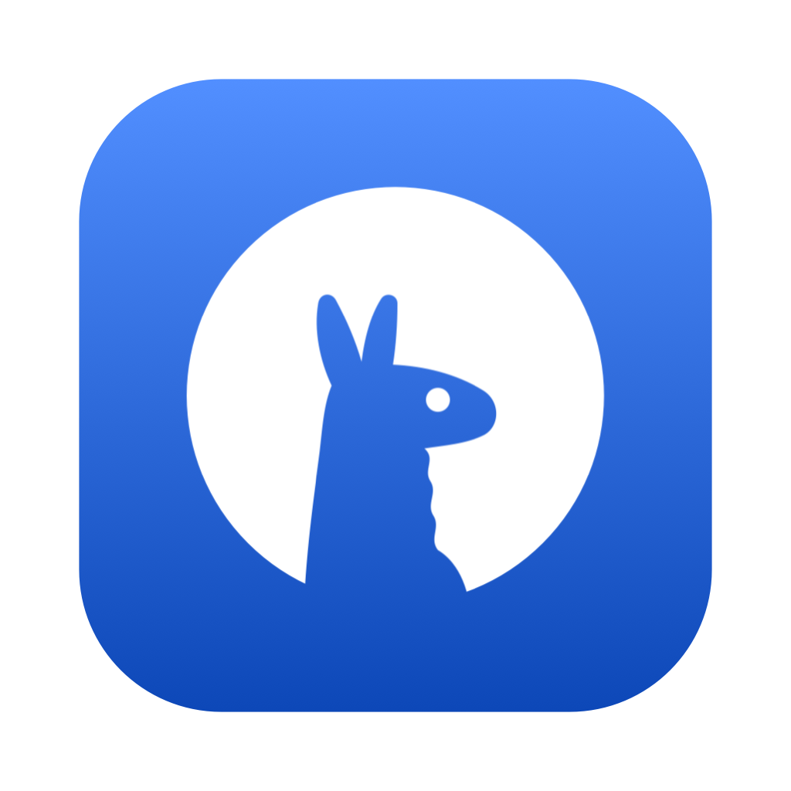
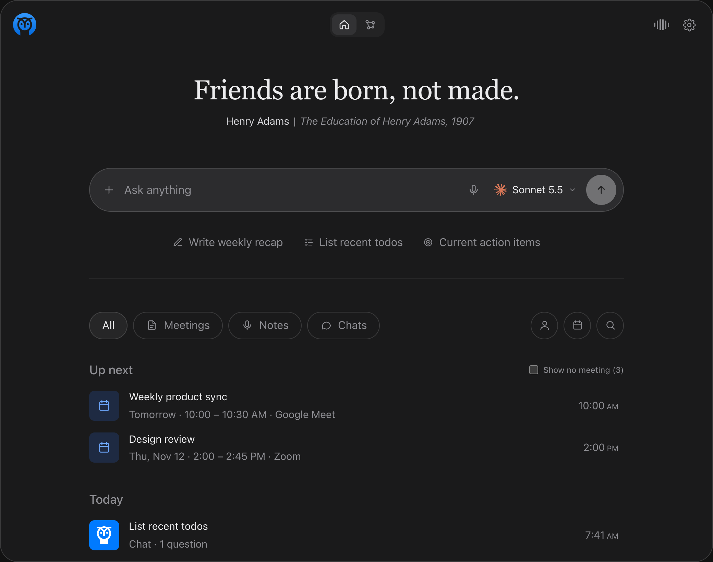
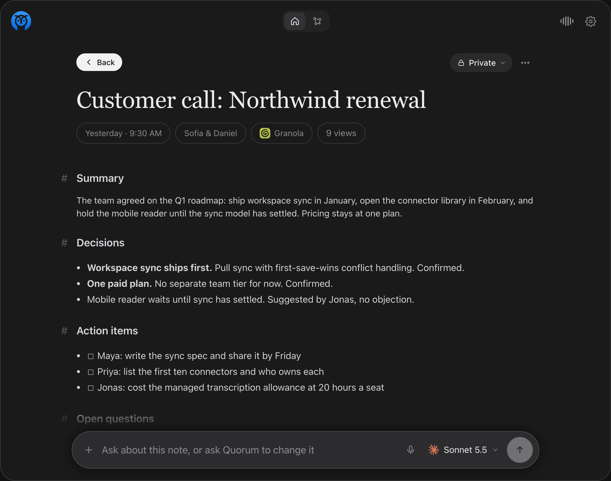
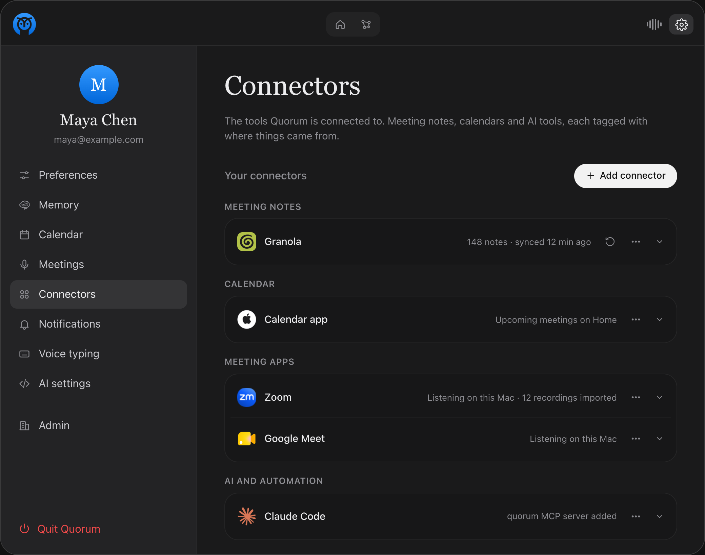
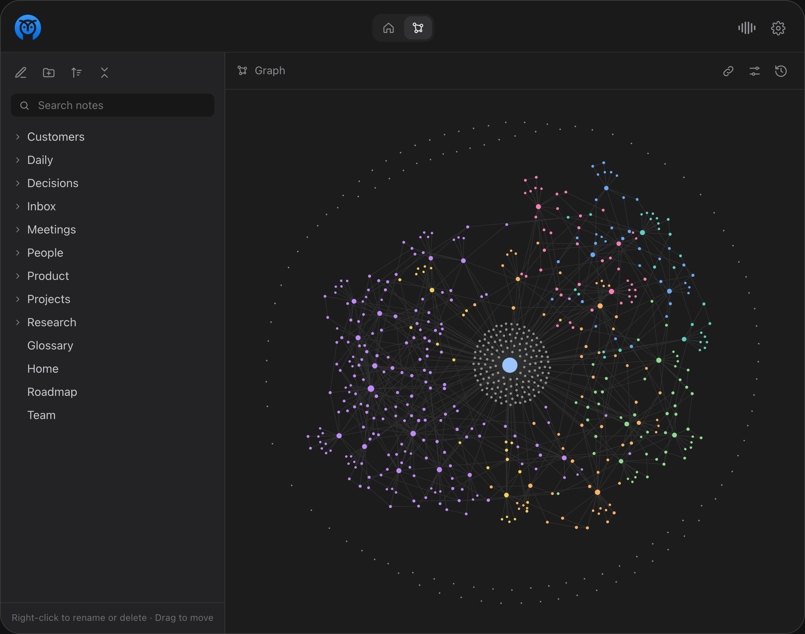
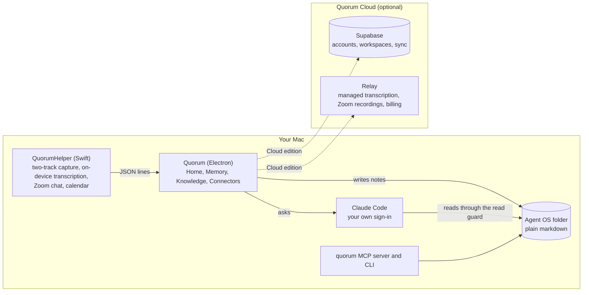

<p align="center">
  
</p>

<h1 align="center">Quorum</h1>

<p align="center">
  <strong>A meeting notetaker that writes into the knowledge folder your AI agents already read.</strong>
</p>

<p align="center">
  <a href="https://github.com/smejkaldesign/quorum/releases/latest">Download for Mac</a> ·
  <a href="#quickstart">Build from source</a> ·
  <a href="docs/self-hosting.md">Self-host</a> ·
  <a href="CONTRIBUTING.md">Contributing</a> ·
  <a href="https://quorum.watch">Quorum Cloud</a>
</p>

> **Beta.** Quorum is in a closed beta. Every install, the open-source edition included, asks for an access code on first launch and does nothing until it has one. Request a code at [quorum.watch](https://quorum.watch); it arrives by email once your signup is approved. The open-source edition stays Apache-2.0; the code gate is a setting for the beta period and goes away when the beta does.

<p align="center">
  <a href="LICENSE"></a>
  <a href="https://github.com/smejkaldesign/quorum/actions/workflows/ci.yml"></a>
  <a href="https://github.com/smejkaldesign/quorum/releases"></a>
  
</p>

---

## What it is

Quorum records both sides of a call on your Mac, transcribes it on-device, and writes the notes as plain markdown into your Agent OS: the folder of notes that Claude Code, Cursor and other agents already read. Nothing is locked in an app database. Questions during and after a meeting run through your own Claude Code sign-in, so there is no Quorum model bill. Audio never leaves the machine.

Most notetakers end at the summary. Quorum treats the summary as the start: the note lands next to your other notes, links to them, shows who and which agents have read it, and the same folder answers questions a week later.

<table>
  <tr>
    <td width="50%"></td>
    <td width="50%"></td>
  </tr>
  <tr>
    <td align="center"><sub><strong>Home.</strong> Up next from your calendar, recent meetings, notes and chats, and one place to ask.</sub></td>
    <td align="center"><sub><strong>A meeting note.</strong> Where it came from, who was there, and how many people and agents have read it.</sub></td>
  </tr>
  <tr>
    <td></td>
    <td></td>
  </tr>
  <tr>
    <td align="center"><sub><strong>Connectors.</strong> Meeting notes apps, calendars, meeting apps and AI tools, each tagged with where things came from.</sub></td>
    <td align="center"><sub><strong>Memory.</strong> The folder and the link graph of every note, searchable, with the agent's read guard in place.</sub></td>
  </tr>
</table>

<sub>Screenshots show sample data from the app's preview build (<code>app/site-preview/</code>).</sub>

## Features

<table>
  <tr>
    <td width="33%" valign="top"><strong>Two-track capture</strong><br>Your mic and the Mac's system audio, recorded as separate channels, so "me" and "them" stay apart in the transcript.</td>
    <td width="33%" valign="top"><strong>On-device transcription</strong><br>Apple's speech engine on the Mac. No audio upload. A managed cloud engine is optional in Quorum Cloud.</td>
    <td width="33%" valign="top"><strong>Notes you own</strong><br>Markdown with frontmatter, written into your own folder, with the recording's source and participants recorded.</td>
  </tr>
  <tr>
    <td valign="top"><strong>Works with Zoom, Meet and Teams</strong><br>Detects the call and listens on this Mac. A notice in the meeting chat lets anyone type STOP to pause the notes and GO to resume. No bot joins the call.</td>
    <td valign="top"><strong>Ask anything</strong><br>During the call or a month later, questions run through Claude Code on your Mac with the whole Agent OS as context.</td>
    <td valign="top"><strong>Memory</strong><br>The folder tree, wikilinks, backlinks and a link graph of every note, with link health checks and relinking tools.</td>
  </tr>
  <tr>
    <td valign="top"><strong>Connectors</strong><br>Import from Granola today, with Zoom cloud recordings in Quorum Cloud. The calendar app feeds Home. Claude Code gets a <code>quorum</code> MCP server in one click.</td>
    <td valign="top"><strong>Who read it</strong><br>Every note shows how many people and which agents have read it, counted by the read guard and the MCP server.</td>
    <td valign="top"><strong>Guardrails</strong><br>One list of what the agent may not read or say: built-in rules, guards found in your folder that you choose to include, your own rules, and your workspace's. Every rule only denies.</td>
  </tr>
</table>

## Editions

One repository, two editions. The Local edition is the default build and costs nothing to run. The Cloud edition adds the parts that need a server.

| | Local (open source) | Cloud |
|---|---|---|
| License and price | Apache-2.0, free | One paid plan, per seat |
| Capture, on-device transcription, Zoom, Google Meet and Microsoft Teams listener, chat notice, end-of-call notes | Yes | Yes |
| Agent OS: connect a notes folder, the Memory graph, search, read guard, views | Yes | Yes |
| Connectors: Granola, the Calendar app, Claude Code MCP | Yes | Yes |
| Model access | Your Claude Code sign-in, or your own API key in Keychain | Same |
| Managed transcription (cloud speech engine, summary and notes on Quorum's keys) | No | 20 hours a month per seat, more in packs |
| Account, workspaces, members, sync across Macs | No | Yes |
| Zoom cloud recordings and transcripts imported automatically | No | Yes |
| Team knowledge: the Knowledge tab over a shared folder or repository, shared notes, roles, review queue | No | Yes |

The rule behind the split: the open-source edition is the same app with the same features, running on your Mac with your own accounts and keys. Anything that needs a server, a company key or a company account is Cloud. Full table and reasoning in `docs/open-source-strategy.md`.

## Quickstart

**Download.** Get the DMG from the [latest release](https://github.com/smejkaldesign/quorum/releases/latest), drag Quorum to Applications and open it. Quorum checks for updates on its own and shows an Update button when a new version is ready. On first launch Quorum asks for Microphone, Screen and System Audio Recording, Accessibility and Calendar access, then creates `~/Documents/Quorum` or connects a folder you already have.

**Build from source.** You need macOS 26 on Apple silicon, Node 22 or newer, Python 3, the Xcode command line tools, and Claude Code installed and signed in.

```sh
git clone https://github.com/smejkaldesign/quorum.git && cd quorum
cd helper && swift build -c release
cd ../app && npm ci && npm run start
```

`npm run start` builds the renderer and launches a development copy named "Quorum Dev" with a green icon. The terminal you launch from needs the same permissions as the app in System Settings, Privacy and Security.

| Command | What it does |
|---|---|
| `npm run start` | Local edition from source. No account, no server. |
| `npm run start:cloud` | Cloud edition against your own Supabase project (`docs/self-hosting.md`). |
| `npm run package` | Signed DMG and zip of the Local edition in `app/release/`. |
| `npm run typecheck`, `npm run lint`, `npm test` | The checks CI runs. |

## The Agent OS

Quorum writes into a folder, and the folder is the product. On first launch it creates `~/Documents/Quorum` with starter files, or connects a folder you already have: an Obsidian vault, or a repository with a `CLAUDE.md`.

```
~/Documents/Quorum/
├── CLAUDE.md                 how agents work in here (marks the folder as an agent root)
├── index.md                  one line per note; Quorum reads it first
├── README.md                 what the folder is
├── 00-inbox/                 quick captures
├── 01-daily/                 one note per day
└── 08-meetings/
    ├── quorum/               notes Quorum writes after each call (source: quorum)
    │   └── 2026-11-09-roadmap-planning.md
    ├── granola/              imported from Granola (source: granola)
    │   └── transcripts/      full transcripts, when "Also import transcripts" is on
    └── zoom/                 Zoom cloud recordings and transcripts (Cloud edition)
```

Quorum looks for a few markers by file name and turns features on when it finds them: `CLAUDE.md` (agent root), `.obsidian` (vault), `index.md` (memory index), `scripts/search-memory.py` (search). Without a marker the feature stays off and nothing breaks.

Three things make the folder safe to hand to an agent:

- **Guardrails.** A Claude Code `PreToolUse` hook, shipped with the app, denies reads of secret-looking files, private folders and any note with `confidential:` in its frontmatter. Settings, Guardrails lists these built-in rules, offers the guard hooks and opt-out lists found in your folder for you to include, takes your own rules, and shows every denial. In Cloud, workspace admins add rules that reach every member.
- **Views.** Each note counts the people who opened it in Quorum and the agents that read it through the guard or the MCP server, with the token estimate.
- **Sync is off by default.** In the Local edition nothing leaves the Mac. In Cloud, hidden paths, private folders and confidential notes are skipped even when sync is on.

Session data (recordings' transcripts, chats) lives in `~/Library/Application Support/Quorum/`, outside the folder, and settings in `settings.json` there.

## Connectors

Connectors bring notes in and let agents out. Each note carries its source in frontmatter and shows it as a chip.

**Live today**

| Connector | Category | What it does |
|---|---|---|
| Granola | Meeting notes | Signs in to your Granola account over MCP and imports every meeting note into `08-meetings/granola/`, with transcripts as an option. Syncs every 30 minutes while Quorum runs. |
| Zoom, Google Meet, Microsoft Teams | Meeting apps | The live listener on this Mac: detects the call, captures both tracks, and posts the STOP and GO notice in the chat. No account and no platform app needed. Zoom cloud recordings import through Quorum Cloud. |
| Calendar app | Calendar | Reads the Mac's calendars so Home shows what is up next and which app each call is on. |
| Google Calendar | Calendar | Reads the calendars you have selected in Google Calendar with your own Google account (read-only scope, PKCE, tokens in Keychain). A build needs a Google OAuth client; `docs/self-hosting.md` says where it goes. |
| Claude Code | AI | One click registers the `quorum` MCP server and CLI on Quorum's own Node runtime. Tools: `list_meetings`, `search_meetings`, `get_meeting`, `list_chats`, `get_chat`, `live_transcript`, `quorum_status`. |

**Next**

Wispr Notetaker, Fireflies and Read AI over MCP; Otter, Fathom and tl;dv by API key; Outlook; Codex and Cursor as MCP clients. The library in `app/connectors/library.js` lists every planned connector with its status, and the adapter contract for meeting sources is in `docs/specs/meeting-sources.md`.

## How it fits together



- `helper/`: the Swift CLI. Audio capture, transcription, Accessibility access to the Zoom chat, calendar read. It speaks JSON lines over stdin and stdout.
- `app/`: the Electron main process (`main.js`), the React window (`src/`), vault index and link tools, the storage boundary (`store/`), the read guard (`guards/`), the CLI and MCP server (`cli/quorum.mjs`), and the connector library (`connectors/`, `sources/`).
- `app/ee/`: Cloud-only client code (account, sync, members, platform connections). Loaded only when the build sets `QUORUM_EDITION=cloud`; `npm run check:edition` fails the build if anything else imports it.
- `relay/`: the Cloud edition's server. Managed transcription over a websocket, the Zoom connection routes, Stripe billing.
- `supabase/`: migrations for the Cloud schema; also runs as a local stack for development.

## Self-hosting the Cloud edition

The Cloud edition runs against a Supabase project you own, with the relay on any Node host. `docs/self-hosting.md` walks through the project, the migrations, the auth mail template, the relay's environment and the build. The Local edition needs none of it.

## Contributing

Read `CONTRIBUTING.md` for setup, the checks CI runs and the commit style. Contributions need a signed [contributor license agreement](CLA.md); a bot asks on your first pull request. Vulnerabilities go to the address in `SECURITY.md`, never to a public issue.

## License

Quorum is open core.

- Everything outside `app/ee/` is licensed under the [Apache License 2.0](LICENSE). See `NOTICE`.
- Files under `app/ee/` are licensed under the [Quorum Enterprise License](app/ee/LICENSE). They are the Cloud edition's client. You may run them for development and testing; production use needs a Quorum Cloud subscription.

<p align="center">
  <br>
  <a href="https://smejkal.design">
    <picture>
      <source media="(prefers-color-scheme: dark)" srcset="docs/images/smejkal-design-dark.svg">
      
    </picture>
  </a>
  <br>
  <sub>Made by Smejkal Design in Portland, Oregon.</sub>
</p>
